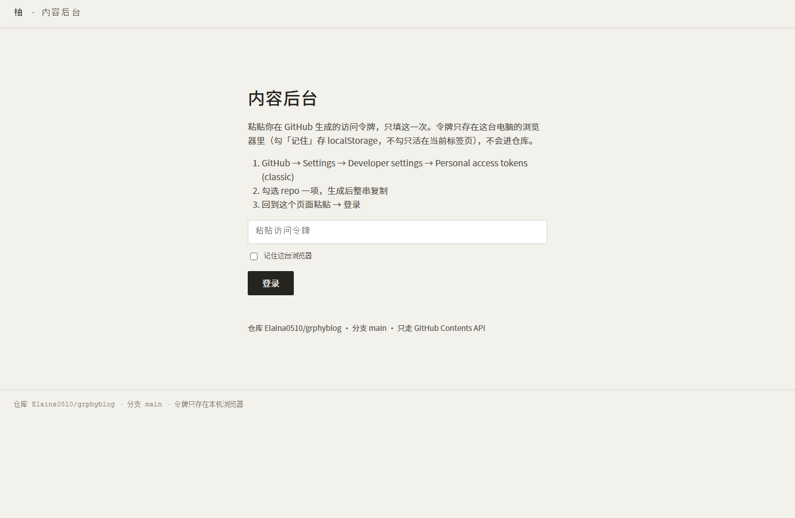
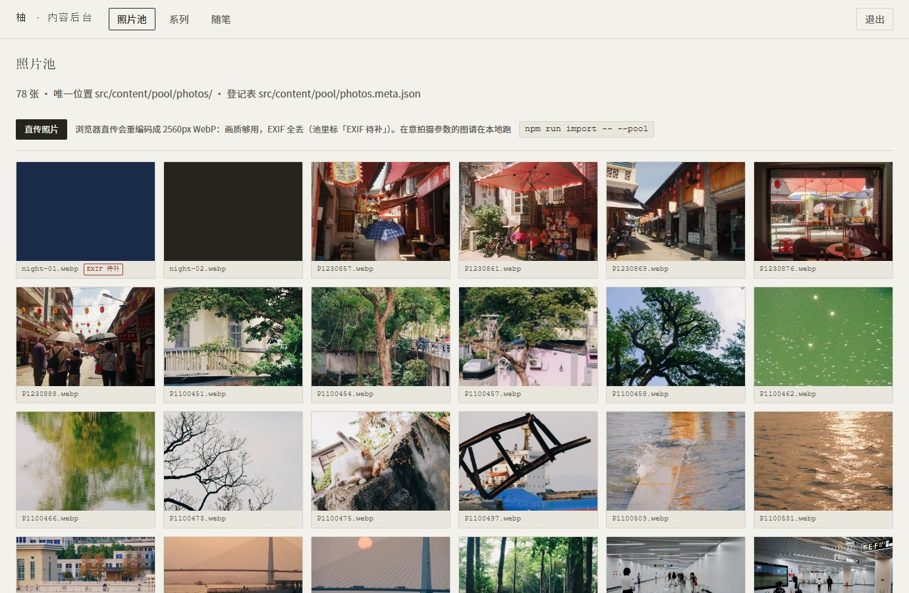
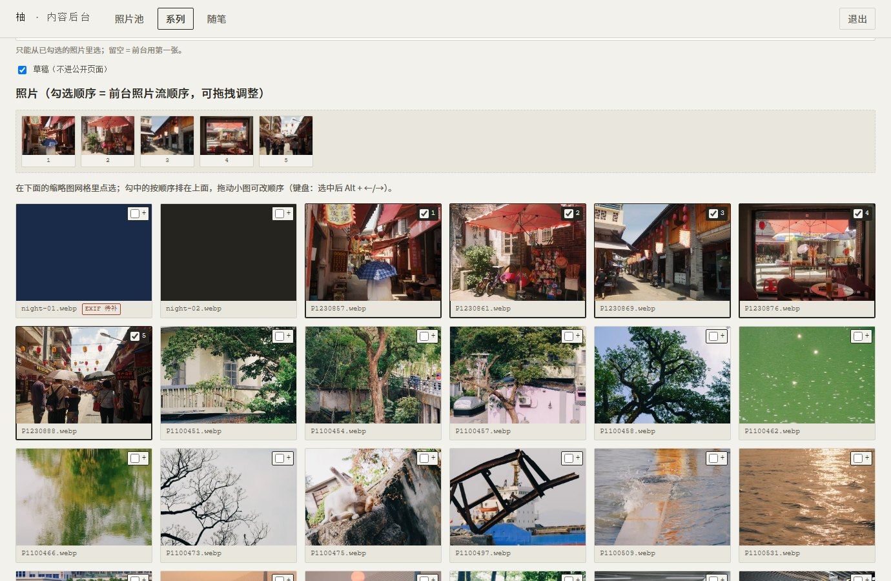

# 内容后台登录指引 · 自建单页后台 + GitHub 访问令牌（v0.1.1）

> 面向：**会用网页点、不写代码**的你。全程在浏览器里做，大约 3~5 分钟。
> 目标：让线上 `https://grphyblog.pages.dev/admin/` 这个内容后台能登录、能改内容。
> 前置：仓库已建好并推上去、Cloudflare Pages 已能访问站点（见 `doc/account-setup.md` 第 2~4 节）。
>
> **状态**：自建后台已在 `public/admin/` 落地（原生 JS + Vditor，无构建步骤、无配置文件），
> 第 4 节有三张界面截图与逐项验收表；照着点一遍就知道链路通不通。

---

## 0. 为什么后台换成了自建单页（一句话版）

通用 CMS（Sveltia / 更早的 Decap）的「关联字段」只能给一个纯文本下拉，**没有缩略图**，
也引用不到照片池；而本站后台最核心的交互就是「一边看缩略图一边勾照片」。
因此后台改为 `public/admin/` 下的一份纯静态单页（原生 JS + Vditor，无构建步骤、无框架、
无配置文件），随站点一起部署。

附带的好处：**仓库里不再有任何后台配置文件**（原来的 `public/admin/config.yml` 已删除）。
后台怎么连仓库，只由这一份文档 + 页面里你自己填的一次性令牌决定，没有第二处配置要对齐。

---

## 1. 先看这张表：谁做什么

| 步骤 | 谁做 | 做完长什么样 |
| --- | --- | --- |
| 1. 在 GitHub 生成一个访问令牌（PAT） | **你在浏览器点** | 一串 `ghp_...` 开头的字符，只显示一次，先存好 |
| 2. 后台页面随站点上线（本仓库改动） | 主 Agent（需你确认推送） | 线上 `/admin/` 出现后台的登录框 |
| 3. 打开后台、粘贴令牌登录 + 验收 | **你在浏览器点** | 进得去，能看到照片池 / 系列 / 随笔三个板块 |

⚠️ **令牌只进你浏览器的 `localStorage`**：不写进仓库任何文件、不进 cookies、不发往任何第三方。
它由页面直接带给 GitHub 的 `api.github.com`（见第 5 节）。

---

## 2. 生成 GitHub 访问令牌（照抄每一步）

1. 用**有仓库写权限的 GitHub 账号**（就是建 `Elaina0510/grphyblog` 那个号）登录 github.com。
2. 打开：**https://github.com/settings/tokens/new**
   （路径：右上角头像 → **Settings** → 左侧最底部 **Developer settings** →
   **Personal access tokens** → **Tokens (classic)** → 右上 **Generate new token (classic)**）
3. 表单从上往下填：

   | 输入框 | 填什么 |
   | --- | --- |
   | **Note**（备注） | `grphyblog admin`（认得出就行） |
   | **Expiration**（有效期） | 建议选 **90 days** 或 **Custom…No expiration**（见第 7 节安全提醒） |
   | **Select scopes**（勾选权限） | **只勾第一项 `repo`**（整行勾选框点一下即可，含子项）。别的都不勾 |

4. 拉到底点 **Generate token**。
5. 页面顶部出现一串 `ghp_...`。点右边的 📋 复制。
   👉 **这串就是全部。它只显示这一次，关掉页面就看不到了**（忘了就回这里再生成一个、把旧的删掉）。

> **不要**勾 `admin:repo`、`delete_repo`、`workflow` 这些——后台只需要读写内容，`repo` 一项就够。
> **不要**用 Fine-grained token：经典 `repo` 令牌与本仓库的公开仓 + 内容读写口径最稳。

---

## 3. 上线本仓库改动（交给主 Agent，需你确认）

这一步是主 Agent 把后台代码（`public/admin/`）提交并推送；它会在推送前向你确认。
**你不用碰命令行。** 推送后等 1~2 分钟 Pages 重建，浏览器打开
**https://grphyblog.pages.dev/admin/**（地址要带斜杠）。

---

## 4. 登录与逐项验收（自建后台已落地）

登录只有一步：把第 2 节的令牌粘贴进 `/admin/` 页面的输入框 → 点 **登录**。

| 要点 | 现状 |
| --- | --- |
| 令牌填在哪 | 页面中间的「粘贴访问令牌」输入框（只填这一次） |
| 记住多久 | 勾「记住这台浏览器」= 存进 `localStorage`，下次打开免填；不勾 = 只活在当前标签页（换标签页就没了） |
| 怎么退出 | 右上「退出」= 清掉浏览器里存的令牌，下次要重新粘贴 |
| 能做什么 | 浏览照片池、直传照片、编辑系列与随笔（字段 + 照片勾选排序 + 正文），保存即一条 commit |
| 不能做什么 | 改仓库配置、改构建脚本、删除 `raw/` 下的原图 |

### 4.1 三张界面截图

> 截图于 2026-10-24 用 Playwright 无头 Chromium 打本地构建产物生成。为了在没有令牌、没有外网的机器上也能出图，
> 后台请求的接口与图片都由本地 mock 应答（照片池数据取自真实的 `photos.meta.json`，其中一条刻意标成「EXIF 待补」用于演示角标）。
> 线上界面与此一致，只是数据来自你的仓库。

**① 登录框** —— 只有一个输入框 + 一个「记住这台浏览器」

**② 照片池** —— 缩略图网格、直传按钮、本地导入命令提示

**③ 编辑页** —— 已选顺序条（可拖拽）+ 勾选网格（缩略图 + 复选框 + 顺序号）

### 4.2 逐项验收（照着点一遍即可）

| # | 做什么 | 看到什么才算过 |
|:--|:--|:--|
| 1 | 打开 `/admin/`，粘贴令牌 → 登录 | 进入「照片池」，顶栏出现 照片池 / 系列 / 随笔 三个板块；池里是带缩略图的照片，张数与 `photos.meta.json` 一致 |
| 2 | 点「系列」→「新建系列」 | 出现字段表单：标题 / 日期 / 标签 / 排序权重 / 封面 / 草稿（**没有标识框**，目录名由标题自动派生） |
| 3 | 在下方缩略图网格里勾几张（点小图或点复选框都行） | 勾中的照片按顺序出现在上方「已选顺序条」并带序号；拖动小图可换顺序（键盘：选中后 Alt + ←/→） |
| 4 | 在「封面」下拉里选一张（或留空 = 前台用第一张） | 下拉里只有已勾选的照片 |
| 5 | 在正文框里写正文（Vditor 富文本；CDN 不通时自动退成纯文本 markdown，内容一样） | 能输入 markdown，插图按 `` 写 |
| 6 | 点「保存」 | 状态行出现「已保存：src/content/series/<标题派生的目录>/index.md（commit …）」；仓库里多一条 commit |

> **关于标识（目录名）**：新建时不用填，后台按标题自动派生 —— 空格换连字符、标点丢掉，
> 中文原样保留，所以「夜光 · 城市」会落在 `src/content/series/夜光-城市/`。
> 输入标题时顶栏的路径会实时跟着变，存之前就能看到最终 URL。
> 中文 URL 在浏览器地址栏里会被自动编码成 `%E5%A4%9C…`，点击与分享都正常。
> 已存在的条目改标题**不会**改目录名 —— 否则旧链接会 404。

| 7 | 等 1~2 分钟（Cloudflare Pages 自动重建） | 前台 `/series/` 出现新系列，照片顺序与后台勾选顺序一致 |
| 8 | 照片池页点「直传照片」选一张图 | 状态行显示「已直传 N 张」；池里多出那张图，带「EXIF 待补」角标（浏览器读不到 EXIF，是既定取舍；要拍摄参数就走本地 `npm run import -- --pool`） |
| 9 | 勾「记住这台浏览器」→ 关掉标签页 → 重新打开 `/admin/` | 免登录直接进照片池；点「退出」后需要重新粘贴令牌 |

> 保存失败别连点：先看状态行的中文提示，再对照第 6 节排障表（401 令牌 / 403 权限 / 409 sha 冲突各有对应动作）。
> 所有写操作只走 GitHub contents API，落在仓库 `Elaina0510/grphyblog` 的 `main` 分支上——每次保存就是一条 commit，想撤销就在 GitHub 上 revert 它。

## 5. 后台是怎么连仓库的（排障时要看的部分）

- 仓库：`Elaina0510/grphyblog`，分支：`main`。
- 只用一个 HTTP 接口族：**GitHub Contents API**（`https://api.github.com/repos/Elaina0510/grphyblog/contents/...`）：
  - 读目录 / 读文件：`GET`（`ref=main`）；
  - 写文件：先 `GET` 拿 `sha`，再 `PUT`（带 `message`，即一条 commit）；
  - 新建照片：`PUT` 到 `src/content/pool/photos/<文件名>`，同时 `PUT` 全局登记表
    `src/content/pool/photos.meta.json`（追加一条 PhotoEntry）。
- 请求头：`Authorization: Bearer <你粘贴的令牌>`；令牌只在这一个 HTTP 请求里，
  仓库里看不到它，也搜不到它。
- 没有 OAuth、没有代理、没有后端服务：令牌就是全部凭据，所以**它等于该账号对本仓库的读写权限**。

---

## 6. 出问题对照表

| 现象 | 大概率原因 | 怎么办 |
| --- | --- | --- |
| `/admin/` 404 | 后台还没上线（E 组未落地），或 Pages 未构建完，或访问的是 `/admin`（没斜杠） | 先确认第 3 步已 push 且 Pages 构建成功；地址补成 `/admin/` |
| 粘贴令牌后报 **401 / Bad credentials** | 令牌复制不全、或已过期/被删 | 回第 2 节重新生成一个，整串复制 |
| 保存报 **403 / Resource not accessible** | 该令牌没勾 `repo`，或该账号对仓库没有写权限 | 重新生成并勾上 `repo`；确认登录的是仓库属主账号 |
| 保存报 **409 / 412**（`sha` 不匹配） | 你编辑这段时间里，别人（或主 Agent）先推了一条 commit | 刷新页面重新读一次文件（拿新 `sha`）→ 再做一次改动保存 |
| 上传后前台看不到图 / 构建红字 `[check-image-sources]` | 上传产物没登记进 `photos.meta.json`，或落到了 `src/content` 之外 | 删掉那个文件重新上传（或走本地 `npm run import -- --pool`）；构建日志会点名具体文件 |
| 刷新后又要重新填令牌 | 没勾「记住」，或浏览器清了站点数据 / 无痕窗口 | 勾上「记住」；用普通窗口 |

---

## 7. 撤销 / 换域名 / 安全红线

- **换电脑、令牌泄漏、不想再让它登录**：GitHub → Settings → **Developer settings** →
  **Personal access tokens** → 找到 `grphyblog admin` → **Delete（撤销）**。
  网站前台不受影响（静态）；下次要再进后台，就再生成一个。
- **换域名**（以后绑自定义域）：改 `astro.config.mjs` 的 `site`（后台页面里的同源基准随之一致）；
  **没有 `config.yml` 要改**——这是退役 Sveltia 之后少掉的一处对齐点。令牌与本流程无关，不用重发。
- **安全红线**：
  1. 仓库里**永远不出现任何令牌**（`.env` / 任何文件 / README 都不行）；令牌只活在浏览器 `localStorage`。
     `tests/unit/decap-cms.test.ts` 会扫 `public/admin/` 下的文件，命中 `ghp_...` / `github_pat_...` 即失败。
  2. 经典 `repo` 令牌权限不小（等于该账号对仓库的读写），**设个有效期**、不用时能一键撤销，是给自己的兜底。
  3. 后台**能改文字、能勾选照片池里的照片、能直传新照片**；但照片的唯一合法位置仍是
     `src/content/pool/photos/` + 全局 `photos.meta.json`，任何落在别处（尤其 `public/`）的图片都会被
     `scripts/check-image-sources.mjs`（`npm run build` 的 prebuild，也就是 Cloudflare Pages 的构建命令）
     打一行 `[check-image-sources]` 红字点名并**失败**——进不了生产。
